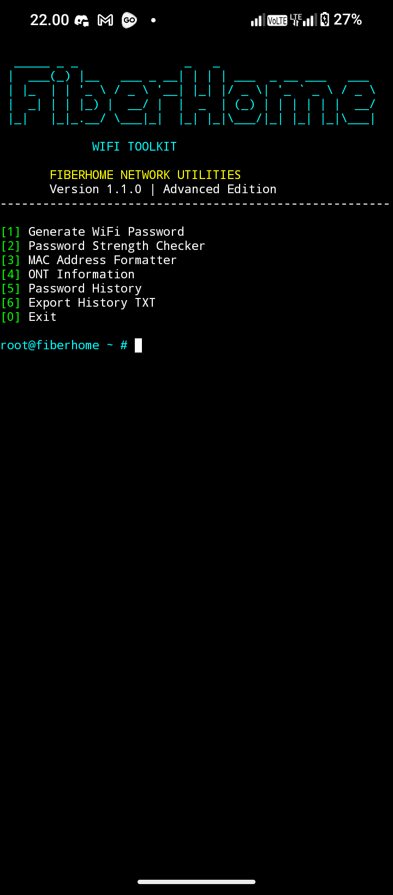

# FiberHome WiFi Toolkit

**Educational WiFi & Network Information Toolkit**

[](https://www.python.org/)
[](https://termux.dev/)
[](LICENSE)

A lightweight Python CLI project built with ❤️ using Termux.

---


## Preview



## Features

- 🔐 Password Generator
- 🛡️ Password Strength Checker
- 🌐 MAC Address Formatter
- 📡 ONT Information Viewer
- 📋 Password History
- 📁 Export Password History

## Requirements

- Python 3
- Termux or Linux

## Installation

```bash
git clone https://github.com/banananaDev/FiberHome-WiFi-Toolkit.git
cd FiberHome-WiFi-Toolkit
python main.py
```

## Project Structure

```text
FiberHome-WiFi-Toolkit/
├── main.py
├── modules/
│   ├── __init__.py
│   ├── password_generator.py
│   ├── password_checker.py
│   ├── mac_info.py
│   ├── ont_info.py
│   └── password_history.py
├── data/
├── assets/
├── requirements.txt
├── README.md
└── LICENSE
```

## Disclaimer

This project is intended for educational purposes and personal network information management. It does not crack WiFi passwords, access routers, or bypass network security.

## Author

**banananaDev**

GitHub: https://github.com/banananaDev
